# OmniSpec

Лаунчер Minecraft для Windows и Linux: сборки, моды и модпаки с **Modrinth** и
**CurseForge**, два типа аккаунтов — лицензия через Microsoft и офлайн-ник, —
и интерфейс в стиле панели OmniPanel: моно-шрифт, плоские панели, ни одного
градиента.

Ядро — `omnispec-core` (чистый Rust, без GUI), интерфейс — Tauri 2 +
HTML/CSS/JS. Меню и подтверждения оформлены в стиле лаунчера; для выбора
файлов используется системный диалог.

**Сайт и скачивание:** <https://shokydo.github.io/OmniSpec/>

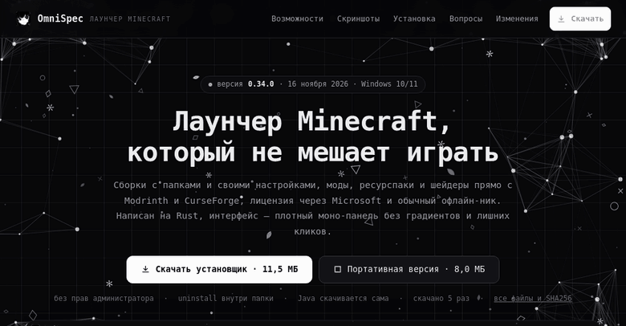

Фон сайта — живая сеть из частиц: 130 точек плывут каждая по своему углу,
связи между ними «дышат» (яркость гуляет ±70 %), а курсор притягивает точки и
тянет к ним линии. Поверх падает снег в три слоя, блоки появляются при
прокрутке, бегунок меню едет за активным разделом.

Анимация работает всегда — в том числе когда в системе включено «уменьшить
движение»: тогда фон просто идёт на 20 кадрах в секунду вместо 60, но не
замирает. Отдельная страница с одним фоном, чтобы посмотреть без лаунчера:
[`docs/bg-demo.html`](docs/bg-demo.html).

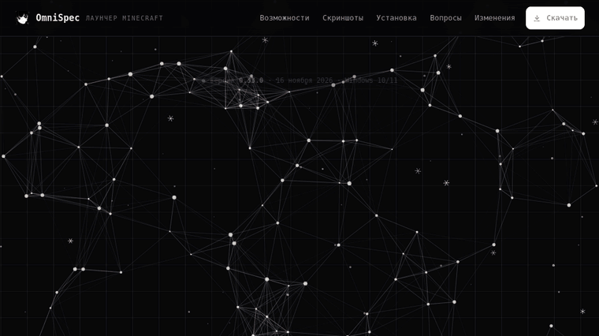

Появление интерфейса тоже живое: окна, ячейки и текст проявляются из
прозрачности и слегка увеличиваются (0.97 → 1). Ячейки встают волной по
диагонали (каждая следующая — на 65 мс позже), текст — за своей карточкой,
заголовок первого экрана собирается по словам, дальше всё срабатывает по
прокрутке.

GitHub не запускает JS и CSS-анимации в README, поэтому здесь запись экрана;
живьём — на **[shokydo.github.io/OmniSpec](https://shokydo.github.io/OmniSpec/)**.

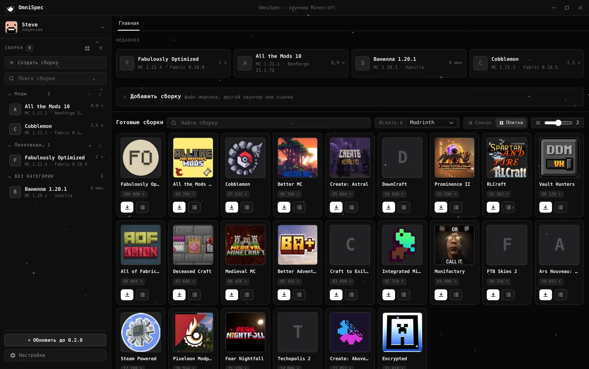

---

## Как это выглядит

Все кадры сняты с текущей версии, без макетов и дорисовок. Клик по картинке
открывает её целиком.

| Главная | CurseForge |
|---|---|
|  | 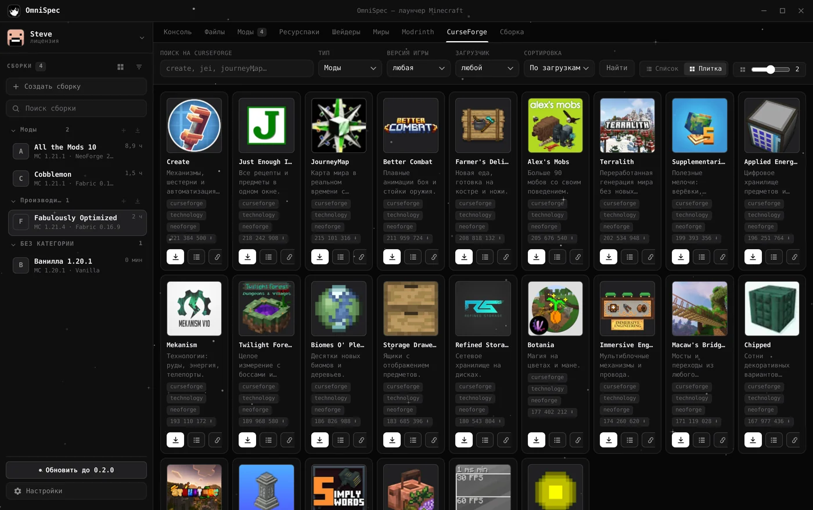 |
| Сверху — недавнее и «Добавить сборку», ниже лента готовых сборок. Список «Искать в» переключает Modrinth и CurseForge, справа — «Список / Плитка» и ползунок размера плитки. | Такие же карточки, как у Modrinth: тип, версия игры, загрузчик, сортировка, догрузка при прокрутке, установка модпака отдельной сборкой. |

| Modrinth | Проект |
|---|---|
| 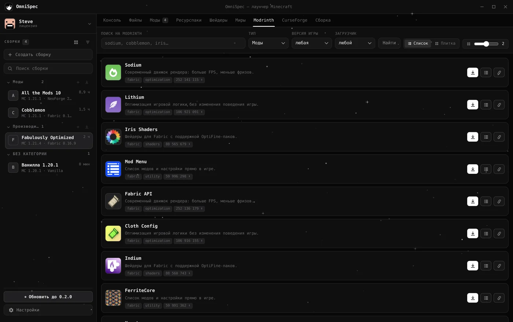 | 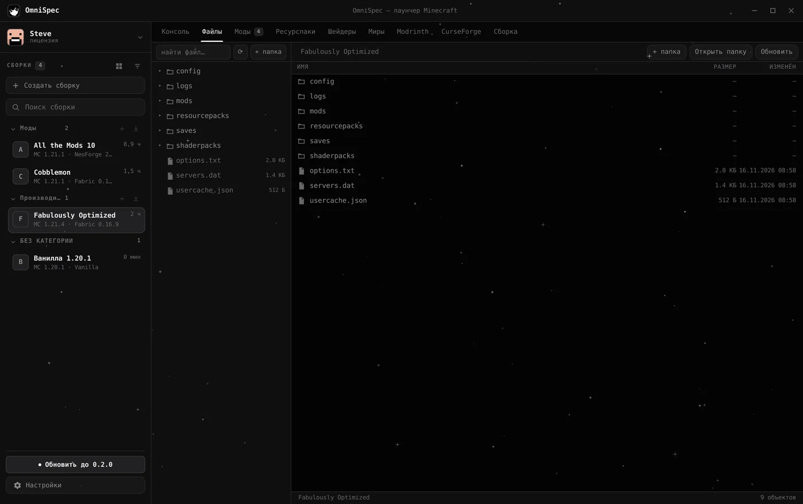 |
| Плитка и список, три размера плитки, бесконечная лента. | Окно проекта: описание, скриншоты, категории, «Установить» и «Версии». |

| Консоль | Моды |
|---|---|
| 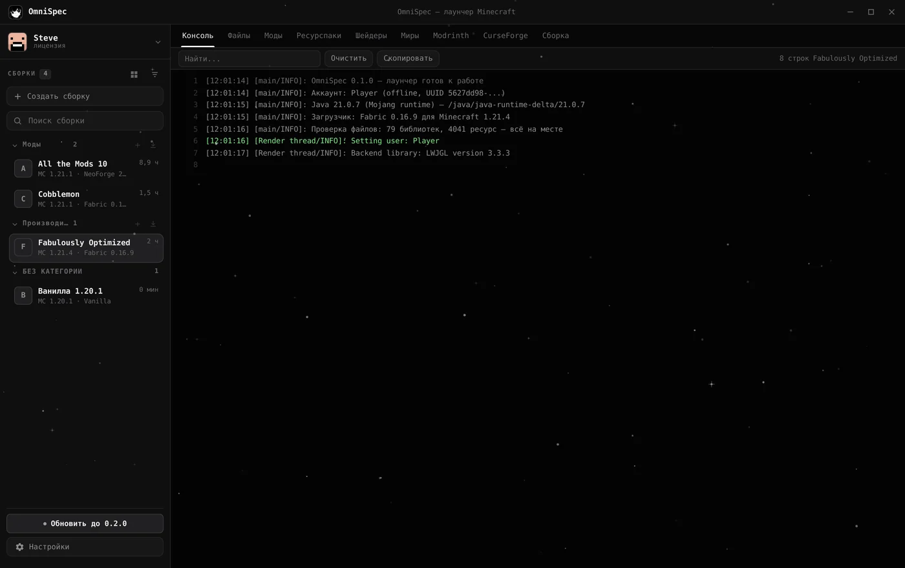 | 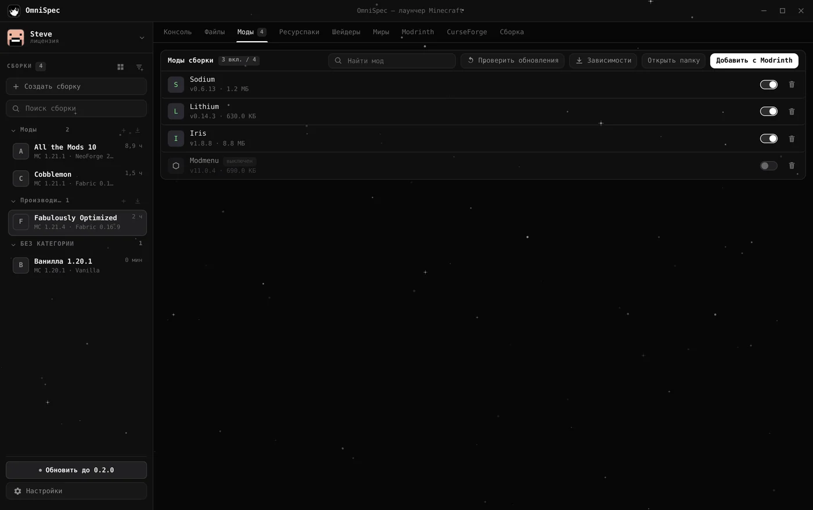 |
| Хвост лога грузится сразу, остальное — догрузкой; поиск, копирование, очистка. | Что реально лежит в сборке, откуда взято и чем выключить. |

| Файлы | Профиль |
|---|---|
|  | 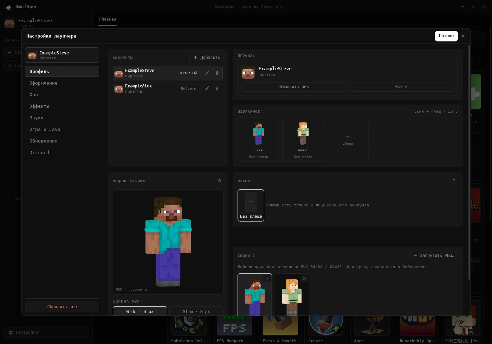 |
| Дерево папок, колонки, просмотр текста и архивов, перенос файлов мышью. | Аккаунты, избранные образы, модель, официальные плащи и библиотека загруженных скинов. |

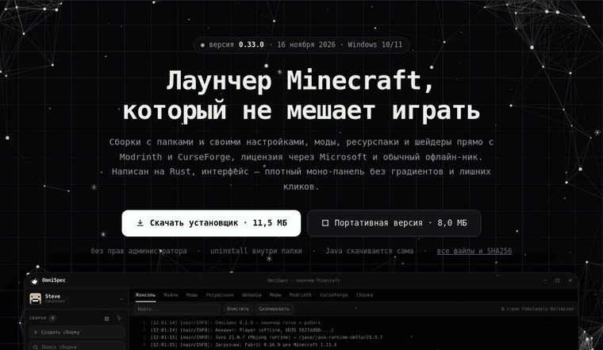

**Сайт при прокрутке.** Разделы всплывают друг за другом, фон из точек плывёт
медленнее страницы, шапка поджимается.

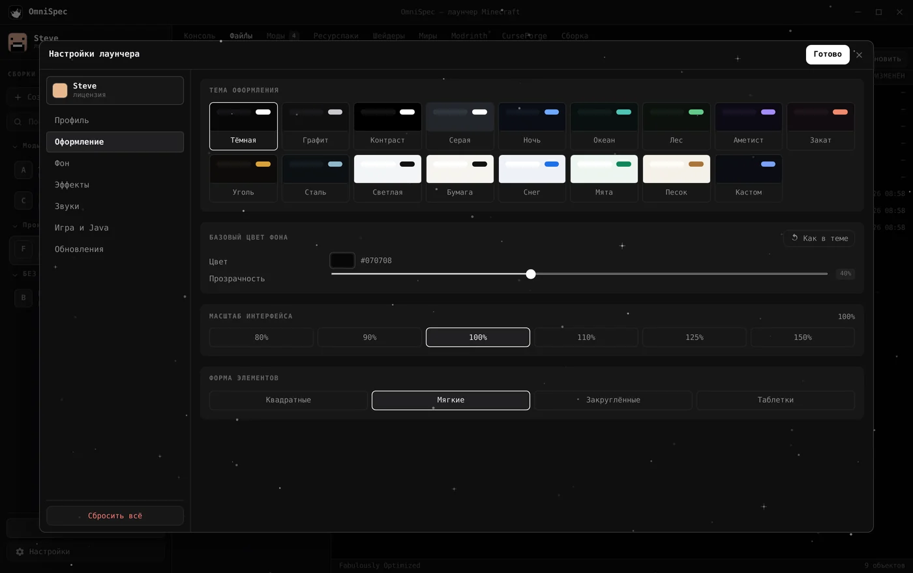

**Настройки.** Категории слева, содержимое справа: 16 тем и «Кастом», фон,
эффекты, звуки, игра и Java, обновления.

---

## Что умеет

### Сборки

| Возможность | Состояние |
|---|---|
| Своя папка у каждой сборки: моды, миры, настройки, память, Java | ✅ |
| Категории-аккордеоны, перетаскивание сборок между ними, «Переместить в» по ПКМ | ✅ |
| Двойной клик по сборке — запуск | ✅ |
| «Запустить дубликат…» с выбором аккаунта — второе окно игры | ✅ |
| «Выключить дубликат» — гасит только это окно, пока игра реально запущена | ✅ |
| Своя иконка сборки: 16 встроенных, первая буква или картинка из файла | ✅ |
| Окно «Все сборки» — сетка иконок по категориям | ✅ |
| Время игры накапливается и не сбрасывается | ✅ |
| Переименование папки сборки в проводнике распознаётся при обновлении списка | ✅ |
| Быстрый повторный запуск: проверка файлов, поиск Java и профиль кешируются | ✅ |
| Своё место установки сборки (по умолчанию — папка лаунчера или любая папка) | ✅ |

При переименовании папки в проводнике вернитесь в окно лаунчера или нажмите
Ctrl+R. Внутренние пути обновятся, внешняя папка игры и внешняя Java останутся
без изменений. Если сборка запущена или идёт установка, дождитесь завершения:
до этого лаунчер не будет переназначать идентификатор активной операции.

### Помощь с ошибками запуска

Во вкладке «Ошибки» выбранной сборки лаунчер локально анализирует новые
строки вывода и ошибки подготовки. Он распознаёт ряд типичных проблем Java,
памяти, загрузчика, модов, сети, графики и доступа к файлам, показывает
возможные действия и позволяет открыть папку сборки. Для отсутствующего Fabric API
и некоторых простых указаний Fabric об установке или замене мода прямо во вкладке
можно нажать «Установить» или «Подобрать и установить версию» — без перехода на сайт.
По запросу лаунчер обращается к каталогу Modrinth, учитывает Minecraft, Fabric,
минимум из лога и указанные в JAR требования к загрузчику и Java, а также проверяет
SHA-512. Сложные интервалы и требования совместимости нескольких модов автоматически
не решаются; наличие других необходимых зависимостей проверяют по новому логу.

Перед установкой проверяются существующие, выключенные и вложенные JAR. Совместимый
выключенный файл можно включить после подтверждения; при подтверждённой замене
прежний файл сохраняется в `omnispec-backups/mods` рядом с папкой `mods` игровой
папки. Несколько копий и неоднозначные случаи автоматически не изменяются. Игра с
той же игровой папкой должна быть остановлена. Если настройки, Java или состав модов
изменились после запуска, сначала повторите запуск. После одного исправления также
нужен новый запуск, чтобы диагностика обновилась.

Разные окна одной сборки разделены по попыткам; ручная остановка не считается
крашем. Сам анализ локальный и не меняет файлы; лог в сеть не отправляется. Только
после нажатия на установку выполняются запросы к каталогу и скачивание. Результаты
доступны до закрытия лаунчера; если причину распознать не удалось, понадобится полный
лог или краш-отчёт. `logs/latest.log` может отсутствовать или перезаписываться
другим запуском; консоль в интерфейсе хранит ограниченный хвост.

### Загрузчики и версии

Fabric, Quilt, Forge, NeoForge и ванилла. Версия игры и версия загрузчика
выбираются двумя списками: при создании сборки и позже в «Сменить версию».
Клиент, библиотеки, нативы и ресурсы качаются с серверов Mojang; версия
снапшотов включается галочкой.

### Источники контента

| | Modrinth | CurseForge |
|---|---|---|
| Поиск с фильтрами по версии игры и загрузчику | ✅ | ✅ |
| Бесконечная лента с догрузкой при прокрутке | ✅ | ✅ |
| Вид «плитка» и «список», три размера плитки (12 / 9 / 6 в ряд) | ✅ | ✅ |
| Окно сведений о проекте: описание, скриншоты, ссылка на страницу | ✅ | ✅ |
| Выбор версии из списка файлов | ✅ | ✅ |
| Автодокачка обязательных зависимостей | ✅ | ✅ |
| Установка из строки поиска и из окна версий | ✅ | ✅ |
| Модпаки | ✅ `.mrpack` | ✅ `manifest.json` + overrides, файлы из API |
| Установка модпака в один клик — сразу отдельной сборкой | ✅ | ✅ |

Ключ CurseForge вшит в ядро и переопределяется переменной окружения
`CURSEFORGE_API_KEY`. Ошибки обеих площадок объясняются по-человечески: не тот
ключ, превышен лимит запросов, автор запретил скачивание через лаунчеры, нет
версии под эту сборку. Если на главной временно не загрузилась лента модпаков,
лаунчер повторяет запрос с увеличивающейся паузой, пока страница открыта;
уже загруженные карточки при сбое догрузки остаются на месте.

При установке мода, в том числе выбранной версии, положение каталога не
сбрасывается. Рамкой и плашкой выделяется мод, если найден реальный JAR его
последней подтверждённой версии под Minecraft и явно указанный загрузчик этой
сборки. Проверяются также импортированные, переименованные и выключенные JAR.
Отметки учитывают выбранный источник и требуют ответа каталога; если файл или
совместимость не удалось подтвердить, рамка не показывается. Панель установки
скрывается через три секунды после завершения операции. При работе с источником
и фильтрами клавиатурой фокус остаётся на выбранном элементе. Enter без выбранной
кнопки не запускает игру: кнопку «Играть» можно активировать Enter или пробелом.

### Discord Rich Presence

В настройках «Discord» можно включить статус и маленькую иконку сборки;
большое изображение — выбранный в «Оформлении» логотип лаунчера. Для сборки
лаунчер показывает встроенный значок или первую букву, а для модпаков —
публичную картинку Modrinth/CurseForge, если она совпадает с локальной.
Discord не принимает локальные пути.

**Свои локальные картинки не отправляются без разрешения.** Если включить
отдельный переключатель, OmniSpec уменьшает и перекодирует выбранную иконку в PNG
без EXIF и анонимно загружает её на сторонний публичный сервис `tmpfile.link`.
Любой, кто получил ссылку, может открыть изображение. По условиям сервиса
анонимные файлы удаляются через 7 дней и не удаляются досрочно; Discord или
другие посредники могут сохранять копии дольше. После отключения переключателя новые
файлы не загружаются, однако ранее опубликованные остаются до истечения срока.
При недоступности хостинга статус продолжает работать с буквенной иконкой.

### Аккаунты

* **Лицензия** — вход через Microsoft по короткому коду на `microsoft.com/link`;
  пароль в лаунчер не попадает, токен живёт час и обновляется сам. Своё
  приложение в Azure не нужно: используется публичный client id официального
  лаунчера и device-code flow (MSA → Xbox Live → XSTS → `login_with_xbox`).
* **Офлайн** — ник 3–16 символов, UUID считается из него, как в самой игре.
* Профиль в шапке слева, до пяти строк аккаунтов со скроллом в настройках,
  переключение, переименование офлайн-ника, копирование ника, удаление.
* **Скины** — модель wide или slim с поворотом на 360°; можно выбрать сразу
  несколько PNG 64×64 или 64×32, сохранить их в библиотеке и затем выбрать
  нужный. Старые загруженные скины остаются доступными. Для лицензионного
  аккаунта текущий скин и аватар загружаются из профиля Minecraft; локальный
  выбор не меняет аккаунт до нажатия «Применить к аккаунту». Ошибки сети и
  обновления входа отображаются в профиле.
* **Плащи** — только официальные плащи лицензионного аккаунта: список с превью,
  переключение и «Без плаща» (`PUT` / `DELETE /minecraft/profile/capes/active`)
  меняют плащ и в ванильной игре.
* **Избранное** — до пяти образов «скин + плащ». Выбор образа выбирает скин и
  пытается переключить доступный аккаунту плащ; для отправки скина в профиль
  нужно отдельно нажать «Применить к аккаунту».

### Импорт и экспорт

* `.mrpack` двойным щелчком (ассоциация ставится установщиком), файлом,
  ссылкой на Modrinth или перетаскиванием в окно.
* `.zip`-модпак как в Prism — версия игры и загрузчик выбираются при импорте.
* Сборки из **Prism Launcher**, **MultiMC** и **Modrinth App** — списком, с
  галочками и мультивыбором.
* Экспорт сборки в `.mrpack` и `.zip` через диалог «сохранить как».
* Импорт видно: живая строка со спиннером, текущий шаг и процент прямо в ленте,
  без отдельного окна.

### Файлы

Дерево папок и колонки, просмотр текста с номерами строк, архивы `zip` и `rar`
(включая просмотр картинок и зум), создание папок, переименование, перенос
файлов мышью, удаление, открытие папки сборки в проводнике.

### Оформление

* **Язык интерфейса**: русский, беларуская, қазақша, українська и English.
  Выбор применяется сразу, сохраняется между запусками и работает без сети.
  Названия сборок, пути, логи и описания сторонних проектов не переводятся.
* **Иконка лаунчера**: исходная или варианты Россия, Беларусь, Казахстан,
  Украина и США. Выбор сохраняется и сразу применяется к шапке окна, значку
  окна и панели задач Windows, а также к большой картинке Discord Rich Presence.
  Маленькая иконка сборки и разрешение на её отправку не меняются.
* 16 тем + «Кастом» с подбором цвета, в том числе **цвета из фона**: палитра
  считается на канвасе по обоям.
* **Обои** — штатная галерея и файлы PNG, JPG, WebP, анимированные GIF,
  MP4 и WebM размером до 512 МБ. Собственные видео проигрываются без звука;
  доступны заполнение, размытие и затемнение. Поддерживаются также прямые
  HTTP(S)-ссылки на эти файлы.
  Для отдельных страниц Imgur определяется ссылка на изображение или GIF;
  для других сервисов нужна прямая ссылка на медиафайл. Страницы и альбомы
  без подходящей ссылки могут не поддерживаться. Интеграция Wallpaper Engine
  удалена: настройки старых версий и файлы не удаляются, рабочий стол не меняется.
* Форма элементов: квадратные, мягкие, закруглённые, таблетки — влияет на все
  окна, включая первый запуск.
* Эффекты: трейс за курсором (линия, кисть, свечение, искры) и частицы на
  экране, со своими цветом и прозрачностью; фоновая анимация (звёзды, пыль,
  палочки, снег); ползунки опускаются до 10 %.
* Звуки интерфейса: мягкий, классический, стекло, дерево, глубокий.
* Масштаб интерфейса 80–150 %.

### Обновления и первый запуск

* Лаунчер сам проверяет GitHub Releases и предлагает обновиться — кнопка
  появляется над настройками, обновление ставится и перезапускает лаунчер.
* Настройки, сборки, миры и время игры при обновлении не теряются, окно первого
  запуска после обновления не возвращается.
* Окно первого запуска: тема, эффекты, трейс, масштаб и импорт сборки — в одном
  месте и по желанию, через «Пропустить».

### Консоль

Хвост лога грузится сразу, остальное — по 300 строк догрузкой; поиск по логу,
копирование, очистка. Игра запускается с правильными аргументами JVM и игры,
Java подходящей версии скачивается автоматически (Java 8 для старых версий,
21 для новых).

---

## Установка

Оба файла лежат в [релизах](https://github.com/Shokydo/OmniSpec/releases/latest)
и собираются GitHub Actions при каждом теге `vX.Y.Z`.

**1. `OmniSpec-Setup.exe` — установщик.** Окно в стиле консоли OmniPanel, но с
кнопками: показывает «Версия / Куда установится / Внутри» и список «Что будет
сделано», даёт сменить папку, делает ярлыки на рабочем столе и в «Пуск».
Права администратора не нужны, лаунчер вшит внутрь. Если лаунчер уже стоит,
предлагает «Запустить», «Переустановить» (файлы обновятся, сборки и миры
останутся) или «Изменить путь». В Windows системные папки ярлыков определяются
самой системой, включая перенаправленный рабочий стол; если ярлык не удалось
создать, установщик сообщает об ошибке, даже если файлы уже распакованы.

**2. `OmniSpec.exe` — портативная версия.** Скачал и запустил; данные (Java,
сборки, миры) лягут в `OmniSpecData` рядом с файлом.

```
OmniSpec.exe          лаунчер
icon.png              иконка для ярлыка
uninstall.exe         деинсталлятор
install-info.txt      версия, путь, режим данных
portable.txt          данные рядом с лаунчером
```

`uninstall.exe` открывает своё окно: путь, галочка «удалить ещё и сборки с
настройками», «Удалить» / «Отмена». Без окна:

```bash
uninstall --yes          # файлы и ярлыки, сборки остаются
uninstall --yes --purge  # стереть ещё и данные
```

### Требования

* **Windows 10/11** x64; на «десятке» нужен WebView2 (обычно уже установлен).
* Linux: `libwebkit2gtk-4.1`, `libgtk-3`, `libsoup-3.0`, `libjavascriptcoregtk-4.1`,
  `librsvg2`; в релизах есть бинарник, локально — `cargo run -p omnispec-app`.
  Для видеообоев нужны системные кодеки GStreamer; например, для H.264 в Debian/Ubuntu
  может потребоваться `gstreamer1.0-libav`.
* Интернет для первого запуска сборки и примерно 1 ГБ на сборку с модами.

Установщик не подписан платным сертификатом, поэтому Windows может показать
«неизвестного издателя»: «Подробнее» → «Выполнить в любом случае».

---

## Сборка из исходников

Нужны Rust (stable 1.77+) и — на Windows — Visual Studio Build Tools с
«Desktop development with C++». Node.js не нужен: интерфейс на чистом
HTML/CSS/JS.

```bash
cargo run -p omnispec-app        # запуск лаунчера
cargo test -p omnispec-core      # тесты ядра
cargo check --workspace          # проверка всего workspace
```

Установщик (необязательно):

```bash
cargo install tauri-cli --version "^2"
cargo tauri build                # target/release/bundle/{nsis,msi,deb,appimage}
```

### Консольная утилита

```bash
cargo run -p omnispec-core --bin omnispec -- versions
cargo run -p omnispec-core --bin omnispec -- create "Моя сборка" --mc 1.21.4 --loader fabric
cargo run -p omnispec-core --bin omnispec -- install moya-sborka
cargo run -p omnispec-core --bin omnispec -- launch moya-sborka --user Steve
cargo run -p omnispec-core --bin omnispec -- search sodium --mc 1.21.4 --loader fabric
cargo run -p omnispec-core --bin omnispec -- modpack fabulously-optimized --install
cargo run -p omnispec-core --bin omnispec -- addmod moya-sborka sodium
cargo run -p omnispec-core --bin omnispec -- update-check
```

### Структура

```
crates/omnispec-core/     ядро без GUI
  game/                   версии, библиотеки, ресурсы, Java, запуск
  loaders/                Fabric, Quilt, Forge, NeoForge
  modrinth/               клиент Modrinth: поиск, версии, установка, .mrpack
  curseforge/             клиент CurseForge: поиск, файлы, установка
  accounts.rs auth/       аккаунты, Microsoft device code, скины и плащи
  content.rs transfer.rs  картотека содержимого, импорт из других лаунчеров
  instances.rs settings.rs paths.rs update.rs
apps/omnispec-app/        Tauri-приложение: main.rs + ui/
apps/omnispec-installer/  установщик и деинсталлятор
site/                     сайт: src/ (шаблоны) → dist/ (публикация)
docs/                     скриншоты и заметки
```

---

## Сайт

Витрина проекта — скачивание, описание и полный список изменений:
**<https://shokydo.github.io/OmniSpec/>**

Исходники в [`site/`](site): `site/src` — шаблоны, стили и скриншоты,
`site/dist` — то, что публикуется. CSS, JS и картинки вкладываются внутрь HTML,
поэтому страницы самодостаточные. Сборка без зависимостей:

```bash
python3 site/build.py            # site/src → site/dist
python3 site/build.py --offline  # без обращения к GitHub API
```

Список изменений собирается из git-тегов, версия и размеры файлов подтягиваются
из GitHub Releases. Публикуется workflow
[`.github/workflows/pages.yml`](.github/workflows/pages.yml) при изменениях в
`site/` и при выходе нового релиза.

---

## Проверка интерфейса

Сценарии ленты, Discord и вкладки «Ошибки» работают с подставным backend;
пользовательские логи и картинки не публикуются. Для диагностики отдельно
проверяются сигнатуры, параллельные запуски, поздний вывод, ручная остановка
и отсутствие перерисовки на каждую строку. Нужны Node.js и Chromium для Playwright:

```bash
cd tools/tests
npm ci
npx playwright install chromium
npm test
```

---

## Выпуск версии

```bash
# версия поднимается в Cargo.toml, apps/omnispec-app/tauri.conf.json и Cargo.lock
git commit -am "…; 0.32.0"
git tag v0.32.0
git push origin main --tags
```

Тег запускает сборку установщика и портативной версии, подсчёт SHA256 и
публикацию релиза; все запущенные лаунчеры увидят обновление. Детали — в
[`docs/UPDATES.md`](docs/UPDATES.md).

---

## Чего нет

* Смена ника лицензионного аккаунта: ник приходит с серверов Mojang.
* Импорт чужого `manifest.json` файлом: модпак CurseForge ставится из каталога,
  а как файл импортируются `.mrpack` и `.zip` формата Prism.

Проект не связан с Mojang Studios и Microsoft. Minecraft — торговая марка
Mojang Studios.
