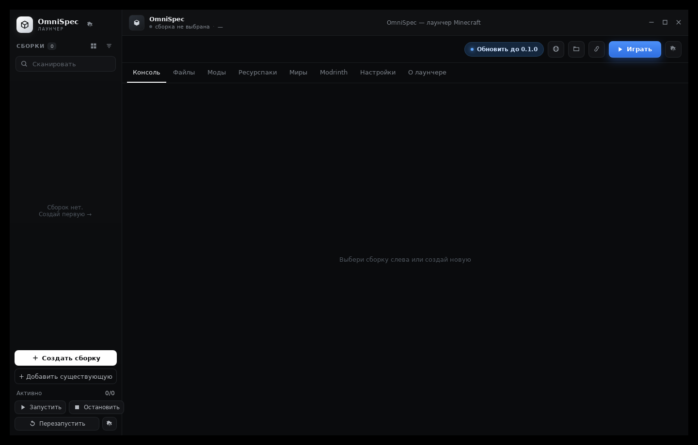
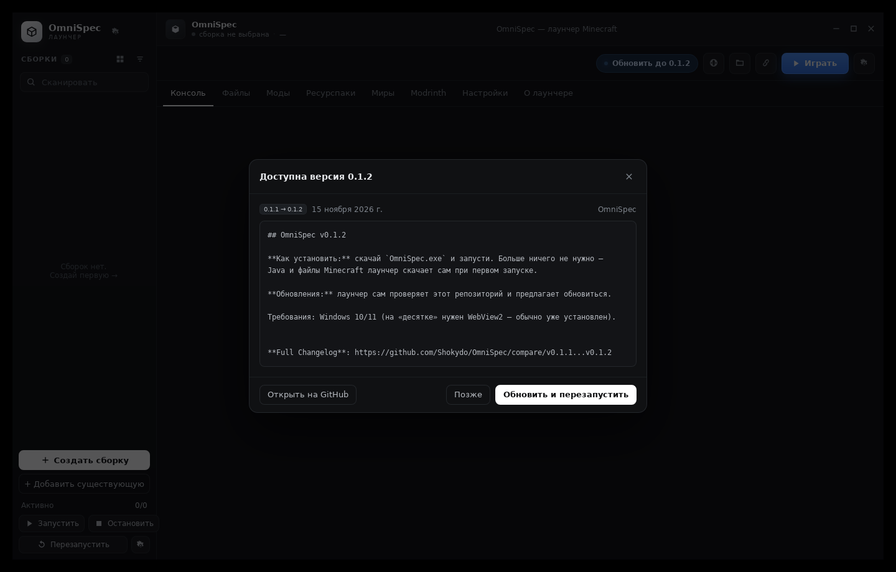
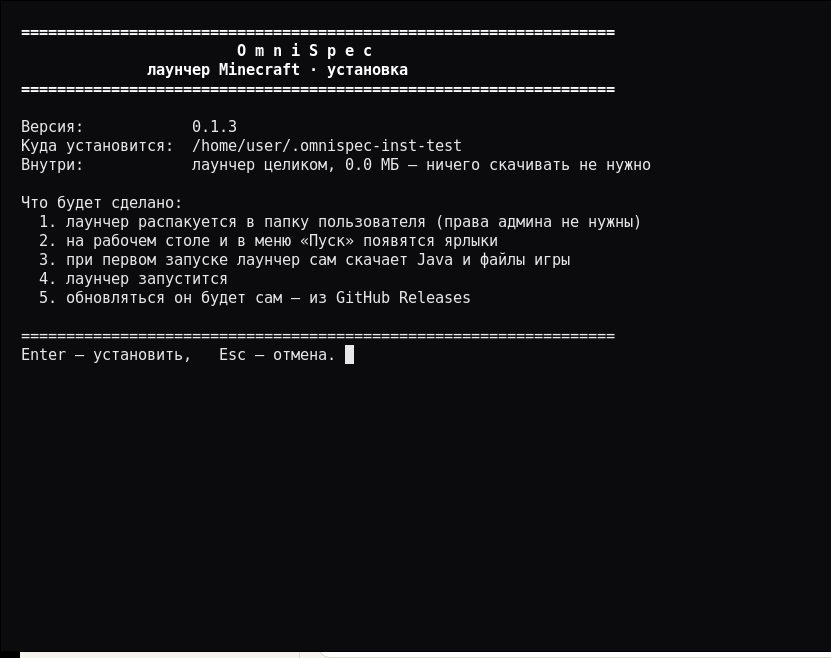
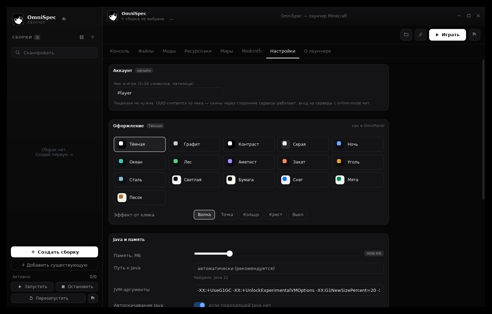

# OmniSpec

Лаунчер Minecraft для **офлайн-аккаунтов** (без лицензии), написанный на Rust.
Ядро — `omnispec-core` (чистый Rust, без GUI), интерфейс — Tauri 2 + HTML/CSS/JS.

Внешне повторяет панель со скриншота: слева список сборок, сверху вкладки
«Консоль / Файлы / Моды / Ресурспаки / Миры / Modrinth / Настройки».


Обновление приезжает само — кнопка появляется в шапке, когда на GitHub выходит новый релиз:





```
┌──────────────┬──────────────────────────────────────────────┐
│ OmniSpec     │  Сборка        Консоль Файлы Моды Modrinth … │
│ СБОРКИ 4     ├──────────────────────────────────────────────┤
│ • Fabulously │                                              │
│ • All the…   │   лог запуска / файлы / моды / поиск модов   │
│ • Ванилла    │                                              │
│ [+ Создать]  │                                     [Играть] │
└──────────────┴──────────────────────────────────────────────┘
```

---

## Что уже работает

Проверено вживую на Minecraft 1.21.4 + Fabric (установка, запуск до окна игры):

| Возможность | Статус |
|---|---|
| Офлайн-аккаунты (UUID как в игре) | ✅ |
| Установка версий: клиент, библиотеки, нативы, ресурсы | ✅ |
| Запуск игры с правильными аргументами JVM и игры | ✅ |
| Автоскачивание Java с серверов Mojang, если её нет | ✅ |
| Fabric и Quilt (готовый профиль из метаданных) | ✅ |
| Forge и NeoForge (официальный инсталлятор) | ✅ (нужен тест на Windows) |
| Сборки: своя папка, свои моды, миры, настройки, память | ✅ |
| Моды с Modrinth + обязательные зависимости | ✅ |
| Модпаки `.mrpack` с Modrinth (создают готовую сборку) | ✅ |
| «Добавить существующую»: поиск по Modrinth, файл `.mrpack`, ссылка | ✅ |
| Импорт локального `.mrpack` | ✅ |
| Просмотр файлов сборки, лог-консоль, вкл/выкл модов | ✅ |
| **Автообновление из GitHub Releases** (кнопка «Обновить и перезапустить») | ✅ |
| **Консольный установщик** (ярлыки, «Пуск», вид как в OmniPanel) | ✅ (Windows — тест в CI) |
| **16 тем + эффект клика** (движок оформления из OmniPanel) | ✅ |
| CurseForge | ❌ (нужен API-ключ, см. `docs/CURSEFORGE.md`) |
| Microsoft/лицензионные аккаунты | ❌ (не цель проекта) |

---

## Сборка и запуск

### 1. Что нужно
* [Rust](https://rustup.rs) (stable, 1.77+) — `rustup default stable`
* Windows 10/11: **WebView2** (в Windows 11 уже есть; на 10 — ставится один раз)
* Visual Studio Build Tools с «Desktop development with C++» (для линковки)
* Node.js **не нужен** — интерфейс на чистом HTML/CSS/JS

Linux (для разработки): `libwebkit2gtk-4.1-dev libgtk-3-dev libsoup-3.0-dev libjavascriptcoregtk-4.1-dev librsvg2-dev`

### 2. Запуск в режиме разработки
```bash
cd omnispec
cargo run -p omnispec-app
```
Первый запуск компилирует зависимости (~3–6 минут), дальше — секунды.

### 3. Два способа поставить

Оба файла лежат в [releases](https://github.com/Shokydo/OmniSpec/releases/latest) и собираются
GitHub Actions при каждом теге `vX.Y.Z`.

**1. `OmniSpec-Setup.exe`** — установщик в стиле OmniPanel: чёрное окно консоли,
шапка с правилами, «Версия / Куда установится / Внутри», список «Что будет сделано»
и Enter/Esc. Разложит лаунчер в `%LOCALAPPDATA%\OmniSpec`, сделает ярлыки на
рабочем столе и в «Пуск», запустит его. Права администратора не нужны, лаунчер
вшит внутрь — качать при установке ничего не надо. У самого установщика та же
иконка, что у лаунчера (`icons/icon.ico` вшивается в exe через `build.rs`,
в свойствах файла — «OmniSpec / Установщик OmniSpec»).



**2. `OmniSpec.exe`** — портативная версия: скачал и запустил, ничего не ставится.
Внутри уже всё, кроме Java и файлов Minecraft (они скачиваются при первом запуске
в `%APPDATA%\OmniSpec`). Обновления лаунчер качает сам из GitHub Releases.

Если запустить установщик повторно, он увидит готовую установку и просто откроет
лаунчер; с флагом `--reinstall` — обновит файлы, сохранив сборки и миры.

### 4. Как выпустить новую версию (для тебя)

```bash
# 1) поднять версию в Cargo.toml → [workspace.package] version = "0.1.1"
git commit -am "release 0.1.1"
git tag v0.1.1
git push origin main --tags
```

Actions соберёт `OmniSpec.exe` и `OmniSpec` (Linux), посчитает SHA256 и опубликует
релиз. Все запущенные лаунчеры увидят обновление. Подробности и правила безопасности
токена — в [`docs/UPDATES.md`](docs/UPDATES.md).

### 5. Сборка установщика (необязательно)
```bash
cargo install tauri-cli --version "^2"
cargo tauri build
```
Готовые файлы появятся в `target/release/bundle/`:
* `nsis/OmniSpec_0.1.0_x64-setup.exe` — установщик для Windows
* `msi/…` — для корпоративного развёртывания
* `deb/…`, `appimage/…` — Linux

Иконка лежит в `apps/omnispec-app/icons/` — замени PNG и пересобери.

### 6. Консольная утилита (проверка ядра без GUI)
```bash
cargo run -p omnispec-core --bin omnispec -- versions
cargo run -p omnispec-core --bin omnispec -- create "Моя сборка" --mc 1.21.4 --loader fabric
cargo run -p omnispec-core --bin omnispec -- install moya-sborka
cargo run -p omnispec-core --bin omnispec -- launch moya-sborka --user Steve
cargo run -p omnispec-core --bin omnispec -- search sodium --mc 1.21.4 --loader fabric
cargo run -p omnispec-core --bin omnispec -- modpack fabulously-optimized --install
cargo run -p omnispec-core --bin omnispec -- addmod moya-sborka sodium
cargo run -p omnispec-core --bin omnispec -- update-check          # есть ли обновление
```

---

## Автообновление

Лаунчер при запуске тихо спрашивает GitHub: «есть ли релиз новее?». Если есть —
в шапке появляется кнопка **«Обновить до X.Y.Z»**: скачивает новый exe, подменяет
себя и перезапускается. Ничего удалять и переустанавливать не нужно.

* Проверяется публичный репозиторий [`Shokydo/OmniSpec`](https://github.com/Shokydo/OmniSpec)
  (можно сменить в настройках, например на форк).
* Токен **не нужен** и в сборку не вшивается: публичные релизы доступны анонимно.
* Замена файла делается процессом-помощником (копия того же exe с флагом
  `--apply-update`), а не `.bat` — пути с кириллицей в `cmd.exe` ломаются.
* Проверено на реальном релизе: версия 0.1.1 скачала 0.1.2, подменила файл
  (sha256 совпал с релизом) и перезапустилась.

Скриншот настроек (**Настройки → Обновления**):


Полное описание, выпуск релиза и разбор проблем — в [`docs/UPDATES.md`](docs/UPDATES.md).

## Оформление (дизайн из OmniPanel)

Палитра, геометрия и движок тем взяты из [OmniPanel](https://github.com/Shokydo/OmniPanel)
(`ui/style.css`): фон `#070708`, панели `#141417`, радиусы 8/12, сайдбар 280 px
с градиентом, белая «инвертированная» primary-кнопка и белая полоска у активной сборки.

В настройках → **Оформление** 16 тем: Тёмная, Графит, Контраст, Серая, Ночь, Океан,
Лес, Аметист, Закат, Уголь, Сталь, Светлая, Бумага, Снег, Мята, Песок. Из четырёх
цветов пресета (фон / панель / текст / акцент) выводятся все переменные интерфейса,
поэтому тема перекрашивает сайдбар, шапку, вкладки, модалки и консоль целиком.
Там же — эффект от клика мышью: волна, точка, кольцо, крест или выключен.



Тема и эффект сохраняются в `settings.json` и применяются при запуске.

Иконка приложения — присланная монохромная картинка; она стоит в сайдбаре,
в шапке окна, на exe, на ярлыках и на панели задач.


Набор собирается одной командой из исходника `apps/omnispec-app/icon-source.jpg`:

```bash
python3 tools/make-icons.py
```

Скрипт отдаёт мастер 1024 px (апскейл + шарп), PNG 32/64/128/256/512,
многоразмерный `icon.ico` (16…256) и логотип для интерфейса. Мелкие размеры
(≤48 px) берутся с кропом 68 % — лицо занимает больше места и иконка читается
на панели задач, крупные — полный кадр, как в исходнике.

## Где лежат данные

По умолчанию (Windows): `%APPDATA%\OmniSpec`
Linux: `~/.local/share/OmniSpec`

```
<данные>/
  settings.json                        настройки лаунчера
  meta/versions/<id>/<id>.json         профили версий (ваниль + загрузчики)
  meta/libraries/                      библиотеки (общие для всех сборок)
  meta/assets/                         ресурсы игры
  instances/<id>/instance.json         описание сборки
  instances/<id>/minecraft/            игровая папка сборки (mods, saves, config…)
  java/java-runtime-*/…                скачанные рантаймы Java
  logs/launch-<id>.log                 журнал запусков
```

**Портативный режим:** положи файл `portable.txt` рядом с `OmniSpec.exe` —
данные будут храниться в папке `OmniSpecData` рядом с программой.
**Свой путь:** переменная окружения `OMNISPEC_HOME=C:\Games\OmniSpec`.

---

## Как устроен код

```
omnispec/
├── crates/omnispec-core/          ядро без GUI (тесты: cargo test -p omnispec-core)
│   └── src/
│       ├── auth.rs                офлайн-аккаунт, UUID v3 от "OfflinePlayer:<ник>"
│       ├── update.rs              автообновление: GitHub Releases, подмена exe
│       ├── paths.rs               раскладка папок, portable-режим
│       ├── settings.rs            settings.json
│       ├── instances.rs           сборки (create/list/save/delete, playtime)
│       ├── net.rs                 HTTP + параллельные загрузки + прогресс
│       ├── game/
│       │   ├── mod.rs             манифест версий Mojang, склейка inheritsFrom
│       │   ├── version.rs         version.json, rules, дедупликация библиотек
│       │   ├── install.rs         клиент, библиотеки, нативы, ресурсы, log4j
│       │   ├── java.rs            поиск Java + загрузка рантайма Mojang
│       │   └── launch.rs          сборка аргументов и запуск процесса
│       ├── loaders/               fabric, quilt, forge/neoforge
│       ├── modrinth/              API v2: поиск, версии, установка, .mrpack
│       └── bin/omnispec.rs        CLI для проверки
├── .github/workflows/             release.yml (exe + релиз), ci.yml (тесты)
├── apps/omnispec-setup/           консольный установщик (вшивает exe лаунчера)
└── apps/omnispec-app/             Tauri-приложение
    ├── src/main.rs                команды (invoke) + события прогресса/лога
    └── ui/                        index.html, styles.css, app.js
```

Важные решения (и почему так):

* **Офлайн-UUID** считается как `md5("OfflinePlayer:<ник>")` с битами версии 3 —
  ровно как у самой игры. Поэтому права на offline-серверах и скины через
  сторонние сервисы совпадают с другими лаунчерами.
* **Дедупликация библиотек.** Fabric приносит свой ASM (9.10.1), а ваниль — 9.6.
  Если оставить оба, JVM падает с `duplicate ASM classes found on classpath`.
  При склейке профилей побеждает версия загрузчика (`game/version.rs`).
* **Свой log4j-конфиг.** Конфиг Mojang пишет в консоль XML (для лаунчера Mojang);
  мы генерируем читаемый, но с тем же файловым логом `logs/latest.log`.
* **Java не обязательна.** Если подходящей версии нет, рантайм скачивается с
  `launchermeta.mojang.com` и распаковывается в `java/` (проверяется реальным
  запуском `java -version`).
* **Обновление без внешнего установщика.** Новый exe заменяется процессом-помощником
  (копия того же exe с флагом `--apply-update`), а не `.bat`: пути с кириллицей в
  `cmd.exe` ломаются, а аргументы Windows передаёт в UTF-16.
* **Разрешения Tauri.** События (`progress`, `game-log`, `game-exit`) не работают
  без `capabilities/default.json` — если добавишь новые API, добавь и права.
* **Интерфейс без бэкенда.** Открой `apps/omnispec-app/ui/index.html` в браузере —
  увидишь тот же интерфейс на демо-данных (`app.js` сам определяет, есть ли Tauri).
* **Forge/NeoForge** ставятся официальным инсталлятором с `--installClient`,
  поэтому файлы попадают в `meta/`, а не в чужой `.minecraft`.

---

## Ограничения офлайн-режима (честно)

* Серверы с `online-mode=true` (лицензионные) не пустят — это не обходится и
  не поддерживается.
* Скины не отображаются у других игроков без мода/плагина (например,
  `CustomSkinLoader` + `ely.by`).
* Ник — это и есть идентификатор: смена ника = новый игрок (другой UUID).

---

## Что дальше (план в духе Prism Launcher)

Ближайшее:
1. Экспорт/импорт сборки в `.mrpack` и `.zip`
2. Резервные копии миров (архив `saves/` перед запуском)
3. Папка `resourcepacks` — установка паков с Modrinth в один клик (UI готов)
4. Обновление модов: показать «есть новая версия» на вкладке «Моды»
5. Переопределение Java/JVM-аргументов на уровне сборки (модель готова)

Дальше:
6. CurseForge как второй источник (см. `docs/CURSEFORGE.md`)
7. Пакетные операции со сборками, группировка, свой порядок
8. Проверка целостности по SHA1 (`settings.verify_hashes`)
9. Скриншоты/логи: просмотр `logs/latest.log` и `crash-reports` прямо в UI
10. Подпись кода (code signing), чтобы антивирусы не пугались подмены exe

---

## Лицензия

MIT. Проект не связан с Mojang/Microsoft. Игра не входит в комплект —
скачивается официально с серверов Mojang так же, как это делает лаунчер Mojang.
