# OmniSpec

Лаунчер Minecraft с **двумя типами аккаунтов** — лицензия (вход через Microsoft)
и офлайн-«пиратка» (просто ник), — написанный на Rust.
Ядро — `omnispec-core` (чистый Rust, без GUI), интерфейс — Tauri 2 + HTML/CSS/JS.

Внешне повторяет панель со скриншота: слева список сборок, сверху вкладки
«Консоль / Файлы / Моды / Ресурспаки / Миры / Modrinth / Настройки».

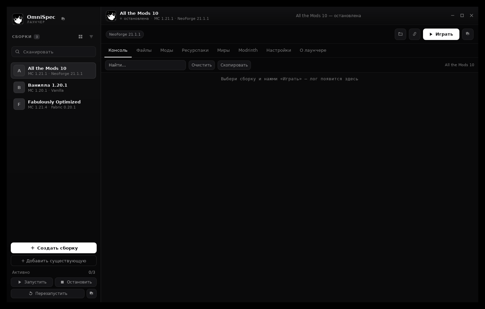

Обновление приезжает само — кнопка появляется в шапке, когда на GitHub выходит новый релиз:


```
┌──────────────┬──────────────────────────────────────────────┐
│ OmniSpec     │  Сборка        Консоль Файлы Моды Modrinth … │
│ СБОРКИ 4     ├──────────────────────────────────────────────┤
│ • Fabulously │                                              │
│ • All the…   │   лог запуска / файлы / моды / поиск модов   │
│ • Ванилла    │                                              │
│ [+ Создать]  │                                     [Играть] │
└──────────────┴──────────────────────────────────────────────┘
```

---

## Что уже работает

Проверено вживую на Minecraft 1.21.4 + Fabric (установка, запуск до окна игры):

| Возможность | Статус |
|---|---|
| **Аккаунты: Microsoft (лицензия) и офлайн** — список, переключение, значки | ✅ |
| Офлайн-аккаунты (UUID как в игре) | ✅ |
| Установка версий: клиент, библиотеки, нативы, ресурсы | ✅ |
| Запуск игры с правильными аргументами JVM и игры | ✅ |
| Автоскачивание Java с серверов Mojang, если её нет | ✅ |
| Fabric и Quilt (готовый профиль из метаданных) | ✅ |
| Forge и NeoForge (официальный инсталлятор) | ✅ (нужен тест на Windows) |
| Сборки: своя папка, свои моды, миры, настройки, память | ✅ |
| Моды с Modrinth + обязательные зависимости | ✅ |
| **Лента Modrinth бесконечная**: догрузка по 24 при прокрутке, «всего N» | ✅ |
| **Выбор версии мода или модпака** перед установкой (с фильтром по MC/загрузчику) | ✅ |
| **Вид результатов: список или плитка** | ✅ |
| **ПКМ по сборке**: играть, настройки, иконка, переименовать, папка, обновить, удалить | ✅ |
| **Своя иконка сборки из картинки** (PNG/JPG/WebP через проводник) | ✅ |
| **Диалоги проводника**: выбор файла `.mrpack`, java, папки | ✅ |
| **Перетаскивание файлов в окно**: `.mrpack`, `.jar`, `.zip`, картинки | ✅ |
| **`.mrpack` открывается двойным щелчком** (ассоциация из установщика) | ✅ |
| Модпаки `.mrpack` с Modrinth (создают готовую сборку) | ✅ |
| «Добавить существующую»: поиск по Modrinth, файл `.mrpack`, ссылка | ✅ |
| Импорт локального `.mrpack` | ✅ |
| **Импорт видно**: спиннер, «сборка копируется в лаунчер», этап и процент | ✅ |
| Файловый менеджер: дерево папок, колонки, просмотр с номерами строк | ✅ |
| Вкл/выкл модов, лог-консоль | ✅ |
| **Автообновление из GitHub Releases** (кнопка «Обновить и перезапустить») | ✅ |
| **Установщик с кнопками** (вид консоли, но окно: кнопки, смена пути, ярлыки) | ✅ (Windows — тест в CI) |
| **Установка ровно в выбранную папку** — путь запоминается для следующих запусков | ✅ |
| **`uninstall.exe` в папке установки** — удаляет файлы, ярлыки и (по желанию) сборки | ✅ |
| **Иконка сборки — с Modrinth**, если модпак оттуда | ✅ |
| **Лента готовых сборок в главном окне** — подгружается прокруткой, ничего не выбирается сама | ✅ |
| **Профиль в шапке слева** — скин и ник активного аккаунта, выпадающий список всех аккаунтов | ✅ |
| **Аккаунты в настройках лаунчера** — раздел «Профиль»: активный аккаунт, список со скинами | ✅ |
| **ПКМ по аккаунту** — выбрать, изменить ник (офлайн), скопировать ник, удалить | ✅ |
| **Вкладки по контексту** — без сборки только лента, со сборкой только её разделы | ✅ |
| **Страницы «Ресурспаки» и «Шейдеры»** — скачивание с Modrinth в свои папки | ✅ |
| **Дизайн панели как в OmniPanel** — моно-шрифт, шапка сборки, компактные строки | ✅ |
| **Главная страница** — свои сборки плиткой, «Создать сборку» и «Добавить существующую» прямо на ней | ✅ |
| **Своя тема** — тема «Кастом» с подбором цвета фона, акцента и текста (ползунок и пипетка) | ✅ |
| **Кнопки-сегменты во всю ширину** настроек — как в панели настроек OmniPanel | ✅ |
| **Читаемая шапка при включённых обоях** — подложка и размытие под строкой пути и вкладками | ✅ |
| **Иконка сборки в шапке окна** — вместо логотипа лаунчера, слева сверху только профиль | ✅ |
| **Импорт без отдельного окна** — .mrpack/.zip, чужие лаунчеры и ссылка прямо на главной | ✅ |
| **Мульти-импорт из лаунчеров** — галочки, «Выбрать все» и импорт пачкой | ✅ |
| **Время игры в часах** — на карточке сборки, в списке слева и на странице сборки | ✅ |
| **Шапка окна на всю ширину** — логотип с названием OmniSpec слева, клик по нему открывает главную | ✅ |
| **Пресеты скина из своих файлов** — только загруженные скины: PNG копируется в папку лаунчера, в пресете остаётся превью головы | ✅ |
| **«Сохранить пресет»** — загрузил скин один раз и применяешь повторно, без поиска файла; удаление по «×» | ✅ |
| **Поворот скина на 360°** — полный оборот модели, wide/slim, второй слой | ✅ |
| **Смена скина через лаунчер** — только для лицензии (Mojang API), PNG 64×64 | ✅ |
| **Окна «Все сборки»** — кнопка «Вид» открывает сетку иконок по категориям, как в Prism; клик открывает сборку | ✅ |
| **Иконки сборок везде** — свои картинки, встроенные символы и буква-заглушка; кэш data-URL, «битых» картинок нет | ✅ |
| **«Выключить дубликат»** — ПКМ по ноде дубликата в «Запущенных» гасит только это окно игры | ✅ |
| **Настройки сборки на всё окно** — таблица в две колонки, кнопки на всю ширину, без блока «Лаунчер» | ✅ |
| **Масштаб интерфейса** — 80 / 90 / 100 / 110 / 125 / 150%, как «размер интерфейса» в Minecraft, сохраняется | ✅ |
| **Фоновая анимация** — падающие звёздочки, пыль, палочки или снег; переключатель и выбор стиля в «Эффектах» | ✅ |
| **Варианты звука** — Мягкий / Классический / Стекло / Дерево / Глубокий, мягкая атака, кнопка «Прослушать все» | ✅ |
| **Версия без лишних кнопок в шапке** — смена версии только на странице сборки («Версия игры» → «Сменить версию») | ✅ |
| **Свои диалоги вместо системных** — подтверждение в стиле лаунчера, нативных окон WebView2 нет | ✅ |
| **Полоса процессов при импорте** — стадия, детали и процент прямо в блоке «Добавить сборку» | ✅ |
| **Категории сборок** — папки-аккордеоны, динамическая «Запущенные» сверху, drag & drop между папками | ✅ |
| **ПКМ по пустому месту списка** — «Создать сборку», «Загрузить сборку», «Создать категорию» | ✅ |
| **«Добавить сборку» на главной** — раскрывающийся список без лишних строк-заголовков | ✅ |
| **Окно сведений о проекте Modrinth** — скриншоты, описание и кнопки «Перейти на сайт / Версии / Установить» | ✅ |
| **Дубликат сборки** — ПКМ → «Запустить дубликат…» с выбором аккаунта (второе окно игры) | ✅ |
| **Дубликаты видны в «Запущенных»** — доп-ноды со скобой и подписью аккаунта под сборкой | ✅ |
| **Перетаскивание сборок между категориями** — свой drag (HTML5 DnD в WebView2 не работает), подсветка папки | ✅ |
| **«Переместить в» в ПКМ по сборке** — категория списком, если тянуть неудобно | ✅ |
| **Уведомление об обновлении снизу слева** — над кнопкой настроек, верхнее поле свободно | ✅ |
| **Окно настроек крупнее** (1080×760), «Сбросить всё» — в левом нижнем углу, быстрые настройки — в низу списка сборок | ✅ |
| **Обои больше не слетают** — выбранный фон сохраняется сразу и применяется при старте | ✅ |
| **Импорт из другого лаунчера**: Prism, MultiMC, Modrinth App — список/плитка, моды и конфиги переносятся | ✅ |
| **Импорт `.zip`-модпака как в Prism** — версия игры и загрузчик выбираются при импорте | ✅ |
| **Экспорт сборки в `.mrpack` и `.zip`** (диалог «сохранить как») | ✅ |
| **Иконки модов в списке модов** — из метаданных jar через Modrinth, список/плитка | ✅ |
| **Смена версии сборки: два списка** — слева версии Minecraft, справа загрузчик и его версии | ✅ |
| **Форма элементов** как в OmniPanel: квадратные / мягкие / закруглённые / таблетки | ✅ |
| **Свои обои** из файла + звуковые эффекты кликов | ✅ |
| **Java 8 для старых версий** отдельно от новой Java (18+) | ✅ |
| **16 тем + эффект клика** (движок оформления из OmniPanel) | ✅ |
| **Оформление без градиентов**: плоские панели, единая сетка высот | ✅ |
| **Обои из OmniPanel** (8 фонов, вписать/плитка, размытие, затемнение) | ✅ |
| **Своя иконка для каждой сборки** (16 встроенных) | ✅ |
| **Прокси и проверка связи с Modrinth** в настройках | ✅ |
| **Настройки лаунчера по категориям** (7 разделов, отдельное окно) | ✅ |
| **Свои настройки у каждой сборки**: имя, иконка, память, Java, JVM-аргументы | ✅ |
| **История обоев**: последние шесть выбранных всегда под рукой | ✅ |
| CurseForge | ❌ (нужен API-ключ, см. `docs/CURSEFORGE.md`) |
| CurseForge-моды | ❌ (нужен API-ключ) |

---

## Сборка и запуск

### 1. Что нужно
* [Rust](https://rustup.rs) (stable, 1.77+) — `rustup default stable`
* Windows 10/11: **WebView2** (в Windows 11 уже есть; на 10 — ставится один раз)
* Visual Studio Build Tools с «Desktop development with C++» (для линковки)
* Node.js **не нужен** — интерфейс на чистом HTML/CSS/JS

Linux (для разработки): `libwebkit2gtk-4.1-dev libgtk-3-dev libsoup-3.0-dev libjavascriptcoregtk-4.1-dev librsvg2-dev`

### 2. Запуск в режиме разработки
```bash
cd omnispec
cargo run -p omnispec-app
```
Первый запуск компилирует зависимости (~3–6 минут), дальше — секунды.

### 3. Два способа поставить

Оба файла лежат в [releases](https://github.com/Shokydo/OmniSpec/releases/latest) и собираются
GitHub Actions при каждом теге `vX.Y.Z`.

**1. `OmniSpec-Setup.exe`** — установщик с кнопками. Выглядит как консоль
OmniPanel (чёрный фон, моноширинный шрифт, шапка из «=», «Версия / Куда
установится / Внутри», список «Что будет сделано»), но это обычное окно: пункты
нажимаются мышью, Enter и Esc работают как раньше.

* **Выбрать папку** — открывается окно выбора прямо в установщике: список
  подпапок, быстрые места (домашняя, рабочий стол, загрузки, диски) и поле, куда
  можно вписать путь руками; `~` разворачивается в домашнюю папку. По умолчанию
  предлагается `%LOCALAPPDATA%\OmniSpec`. Тот же путь попадает в ярлыки на
  рабочем столе и в «Пуск».
* **Установить / Отмена** — установка идёт по шагам со галочками, потом окно
  предлагает «Запустить лаунчер», «Открыть папку» или «Закрыть».
* Если лаунчер уже стоит, окно предлагает «Запустить лаунчер»,
  **«Переустановить»** (файлы обновятся, сборки и миры останутся) или
  «Изменить путь» (то же окно выбора папки).
* Права администратора не нужны, лаунчер вшит внутрь — качать при установке
  ничего не надо. Иконка установщика — та же, что у лаунчера
  (`icons/icon.ico` вшивается через `build.rs`, в свойствах файла —
  «OmniSpec / Установщик OmniSpec»).


Смена пути установки:

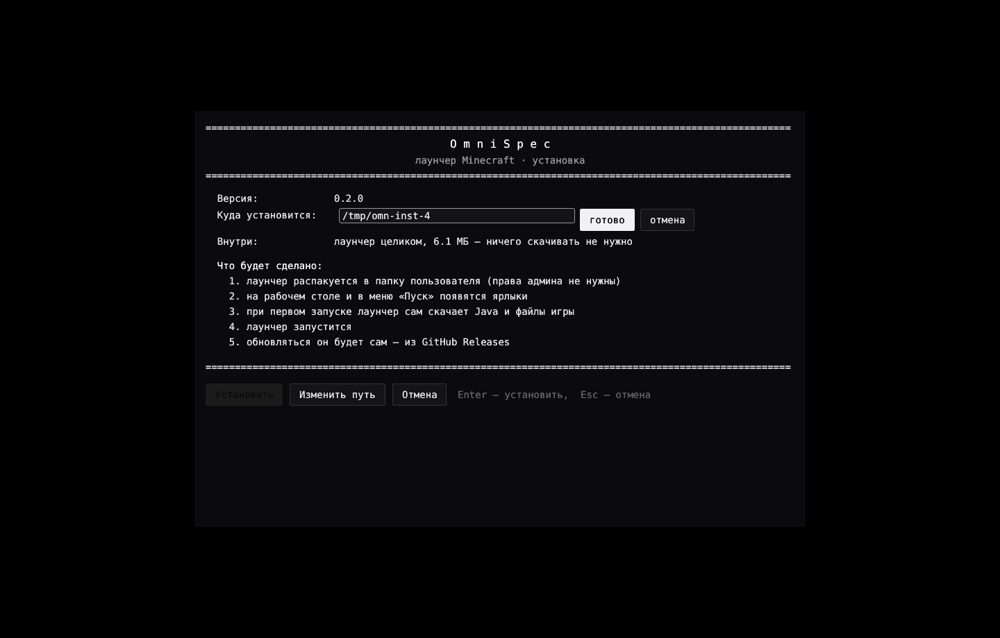

Установка и итоговый экран:

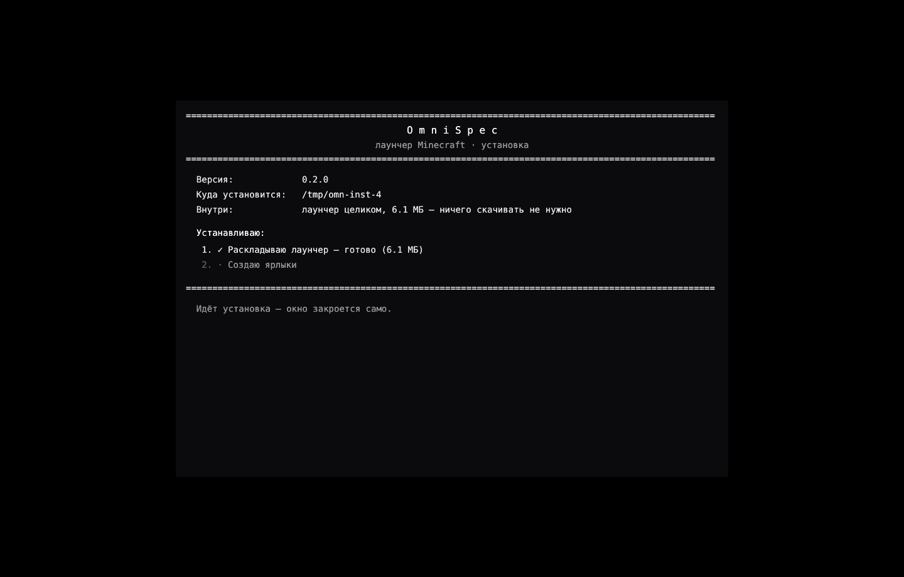
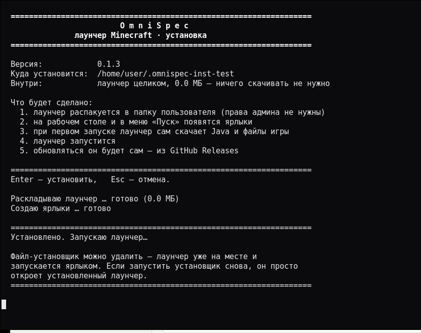

Если окно открыть не удалось (нет OpenGL или дисплея), тот же сценарий
показывается в консоли — тем же визардом со стрелками и Enter/Esc:


**2. `OmniSpec.exe`** — портативная версия: скачал и запустил, ничего не ставится.
Внутри уже всё, кроме Java и файлов Minecraft (они скачиваются при первом запуске
в `%APPDATA%\OmniSpec`). Обновления лаунчер качает сам из GitHub Releases.

**Куда ставится.** Ровно в ту папку, которая указана в установщике — никаких
подстановок «в Документы» позади твоей спины. Выбранный путь запоминается
(`%LOCALAPPDATA%\OmniSpec-install-location.txt`), поэтому следующий запуск
установщика предлагает уже его. Если папка недоступна для записи, установщик
скажет об этом до копирования файлов.

**Что лежит в папке установки.**

```
OmniSpec.exe          лаунчер (папка, которую выбрал, — его дом)
icon.png              иконка для ярлыка
uninstall.exe         деинсталлятор
install-info.txt      версия, путь, режим данных, куда поставлено
portable.txt          данные рядом с лаунчером (если не отключал)
```

**`uninstall.exe`** — обычный запуск открывает окно деинсталлятора: «Удаляю из:
<путь>», галочка «удалить ещё и сборки с настройками», кнопки «Удалить» и
«Отмена». Убирает файлы лаунчера, ярлыки с рабочего стола и из «Пуск», по
галочке — сборки, миры, Java и настройки; себя доудаляет после выхода и убирает
опустевшую папку. Без окна:

```bash
uninstall --yes          # файлы и ярлыки, сборки остаются
uninstall --yes --purge  # стереть ещё и данные
```

**Данные.** По умолчанию установщик включает портативный режим: Java, сборки и
миры лежат в `OmniSpecData` рядом с лаунчером. Галочку «данные рядом с
лаунчером (портативно)» можно снять — тогда данные пойдут в профиль
(`%APPDATA%\OmniSpec`). Флаг `--shared` делает то же самое в тихом режиме,
`--portable` — наоборот.

Если запустить установщик повторно, он увидит готовую установку и просто откроет
лаунчер; с флагом `--reinstall` — обновит файлы, сохранив сборки и миры.
Полный список флагов: `omnispec-setup --help`.

### 4. Как выпустить новую версию (для тебя)

```bash
# 1) поднять версию в Cargo.toml → [workspace.package] version = "0.1.1"
git commit -am "release 0.1.1"
git tag v0.1.1
git push origin main --tags
```

Actions соберёт `OmniSpec.exe` и `OmniSpec` (Linux), посчитает SHA256 и опубликует
релиз. Все запущенные лаунчеры увидят обновление. Подробности и правила безопасности
токена — в [`docs/UPDATES.md`](docs/UPDATES.md).

### 5. Сборка установщика (необязательно)
```bash
cargo install tauri-cli --version "^2"
cargo tauri build
```
Готовые файлы появятся в `target/release/bundle/`:
* `nsis/OmniSpec_0.1.0_x64-setup.exe` — установщик для Windows
* `msi/…` — для корпоративного развёртывания
* `deb/…`, `appimage/…` — Linux

Иконка лежит в `apps/omnispec-app/icons/` — замени PNG и пересобери.

### 6. Консольная утилита (проверка ядра без GUI)
```bash
cargo run -p omnispec-core --bin omnispec -- versions
cargo run -p omnispec-core --bin omnispec -- create "Моя сборка" --mc 1.21.4 --loader fabric
cargo run -p omnispec-core --bin omnispec -- install moya-sborka
cargo run -p omnispec-core --bin omnispec -- launch moya-sborka --user Steve
cargo run -p omnispec-core --bin omnispec -- search sodium --mc 1.21.4 --loader fabric
cargo run -p omnispec-core --bin omnispec -- modpack fabulously-optimized --install
cargo run -p omnispec-core --bin omnispec -- addmod moya-sborka sodium
cargo run -p omnispec-core --bin omnispec -- update-check          # есть ли обновление
```

---

## Аккаунты

Слева внизу — список аккаунтов: ник и значок (**лицензия** / **пиратка**).
Клик по строке переключает активный аккаунт, крестик в окне аккаунтов удаляет.

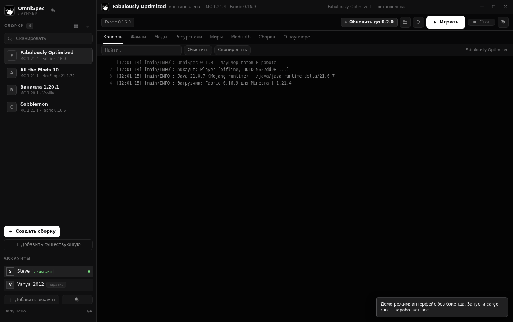

В заголовке каждой категории — две маленькие иконки: **«+»** (создать сборку
именно в этой категории) и **«↓»** (загрузить туда `.mrpack`/сборку из папки).

Список сборок работает и с правой кнопкой:

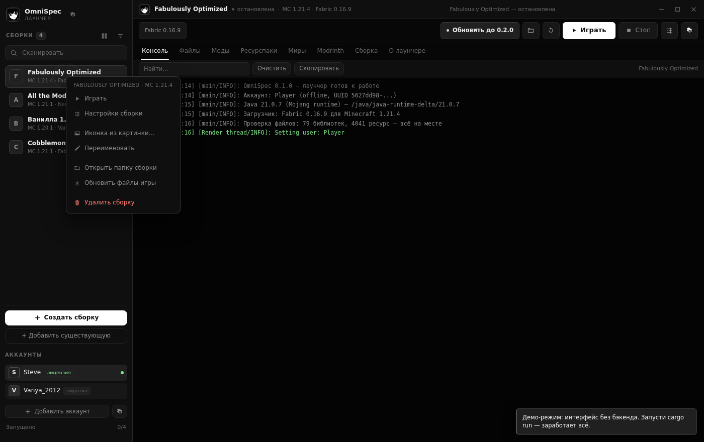

В заголовке списка одна кнопка — **«Добавить аккаунт»**; тип выбирается уже в окне
аккаунтов, а не кнопками «Пиратка»/«Лицензия» в самом заголовке.

**Добавить аккаунт** → выбор из двух вариантов:

* **Лицензия** — вход через Microsoft по короткому коду: лаунчер показывает код,
  ты вводишь его на `microsoft.com/link` (или в приложении Microsoft на телефоне),
  лаунчер сам забирает токен. Пароль в лаунчер не попадает и нигде не хранится.
* **Пиратка** — просто ник (3–16 символов, латиница/цифры/`_`). UUID считается
  из ника, как в самой игре.

Технические детали лицензионного входа:

* своё приложение в Azure **не нужно** — используется публичный client id
  официального лаунчера `00000000402b5328` и device-code flow;
* цепочка: MSA → Xbox Live → XSTS → `login_with_xbox` → профиль Minecraft;
* токен живёт час и обновляется сам по `refresh_token` перед запуском игры;
* ошибки объясняются по-человечески: нет Xbox-профиля, детский аккаунт, страна,
  где Xbox Live недоступен;
* свой client id из интерфейса не настраивается: раздела «Сеть» в настройках больше
  нет, используется публичный client id официального лаунчера.

### Плащи аккаунта

В настройках профиля под аккаунтами — блок **«Плащ аккаунта»**: лаунчер
забирает с `api.minecraftservices.com/minecraft/profile` список плащей
аккаунта (с превью), показывает, какой надет, и позволяет переключить или
**выключить плащ совсем**:

* клик по плащу → `PUT /minecraft/profile/capes/active` с его `capeId`;
* «Без плаща» → `DELETE /minecraft/profile/capes/active` — плащ пропадает и в игре;
* кнопка ⟳ справа — перечитать список (например, после покупки плаща).

Плащи есть только у лицензионного аккаунта; у офлайн-ника блок честно пишет об
этом. Изменение применяется на стороне Mojang, значит видно и в ванильном
лаунчере.

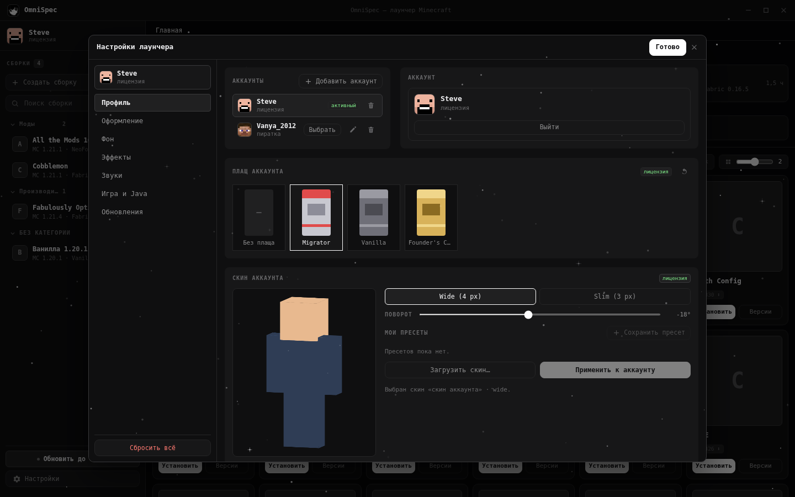

Список аккаунтов лежит в `accounts.json` рядом с настройками.

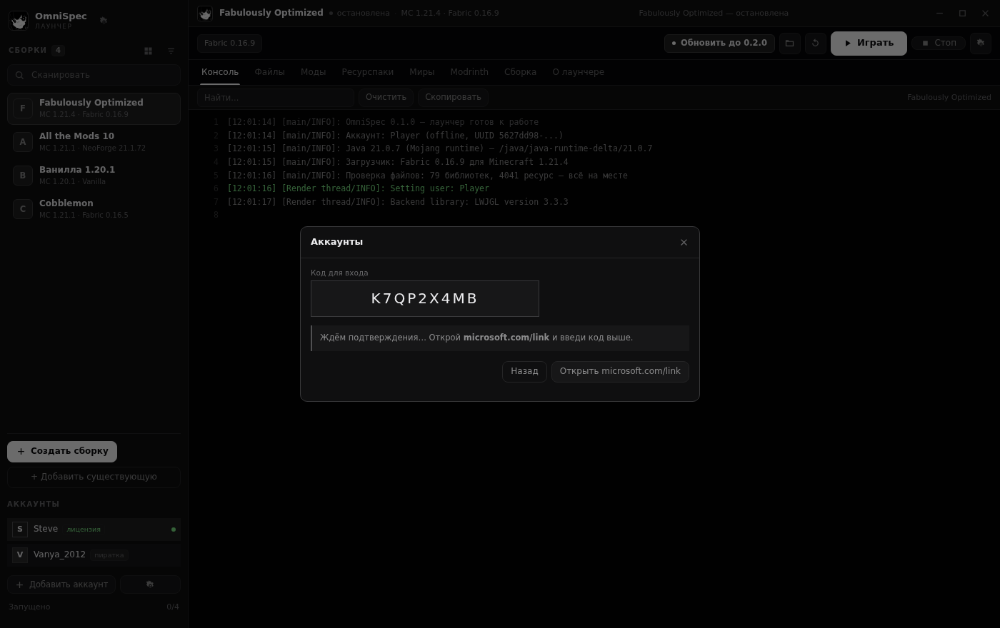

## Настройки: лаунчер и сборка — это разное

* **Настройки лаунчера** — отдельное окно (кнопка ⚙ рядом с аккаунтами или
  шестерёнка в шапке). Разделы: Оформление, Обои, Эффекты, Игра и Java, Сеть,
  Обновления, О лаунчере. Это общие значения по умолчанию.
* **Настройки сборки** — вкладка «Сборка» в самом лаунчере: имя, иконка, память,
  путь к Java, JVM-аргументы, заметка — **только для этой сборки**. Пустое поле
  означает «как в общих настройках».

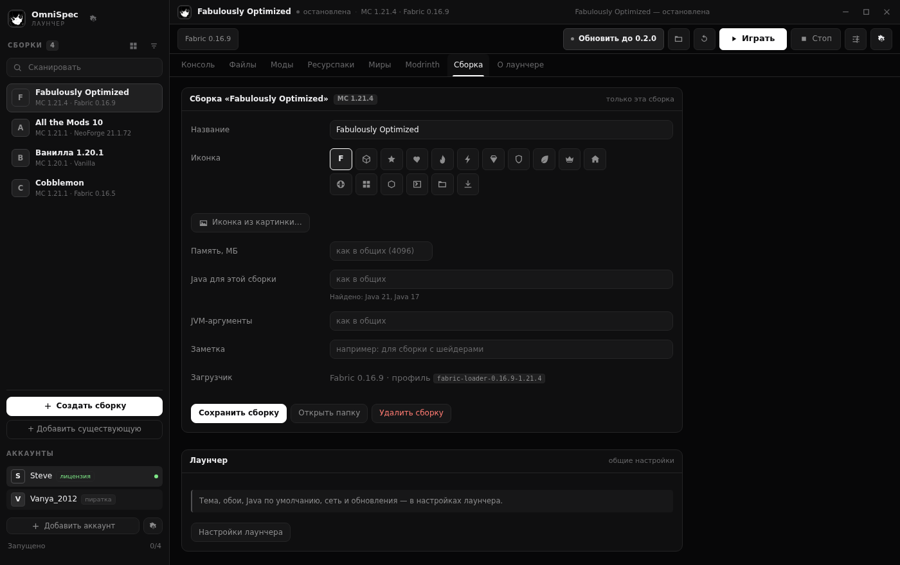

## Оформление

Настройки лаунчера → «Оформление»: 16 тем и эффект клика. Обои живут в
отдельном разделе «Обои»: галерея из OmniPanel (`ui/assets/wallpapers/`) по
группам — градиенты, текстуры, природа, — вписать/растянуть/плиткой, размытие,
затемнение и **история**: последние шесть выбранных фонов остаются под рукой.
Когда обои включены, панели становятся полупрозрачными, а консоль и файловый
менеджер остаются тёмными, чтобы текст читался.

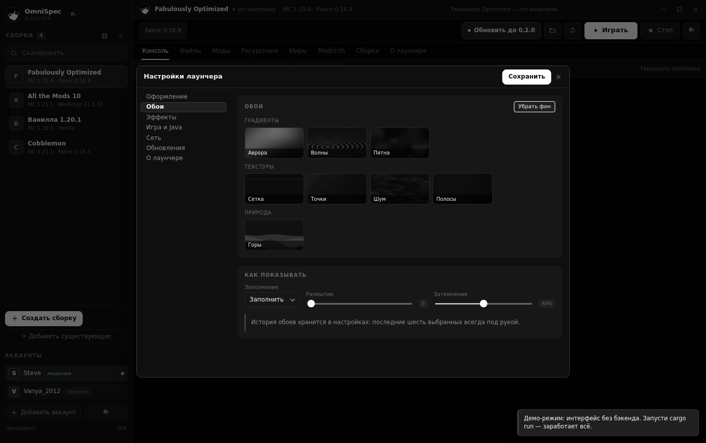

### Своя тема: цвета из фона

Тема «Кастом» собирает палитру из твоей картинки: кнопка **«Цвета из фона»**
берёт обои (свою фотографию или штатный фон), считает по ним три цвета —
поверхности (`фон`), самый насыщенный оттенок (`акцент`) и читаемый текст — и
сразу перекрашивает интерфейс. Кнопки «Подобрать» у каждого цвета делают то же
самое для одной строки; если обоев нет, открывается обычная пипетка. Палитра
считается на канвасе, поэтому «свой фон» (data-URL) тоже подходит, а выбранные
цвета сохраняются сразу.

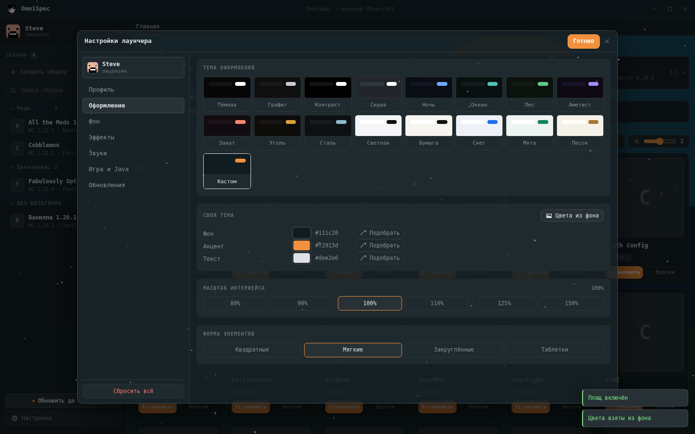

Иконка сборки: 16 встроенных значков, первая буква названия или **своя
картинка** (PNG/JPG/WebP — из настроек сборки или из меню по правой кнопке).
Файл копируется в папку сборки как `icon.<ext>`, поэтому переживает перезапуск. Хранится в `instance.json` (поле `icon`), поэтому переживает
перезапуск и переустановку.

### Что видно во время импорта

Пока сборка разворачивается в лаунчер, панель «Добавить сборку» раскрывается
сама и показывает **живую строку**: спиннер, заголовок «Сборка копируется в
лаунчер» (или «Идёт установка сборки», когда уже качаются файлы), текущий шаг
(«модпак: распаковываем overrides · 50 %») и полосу прогресса. В шапке
одновременно идёт общая полоса с тем же текстом. Строка исчезает, когда импорт
закончился, — ни одна сборка не появляется «вдруг».

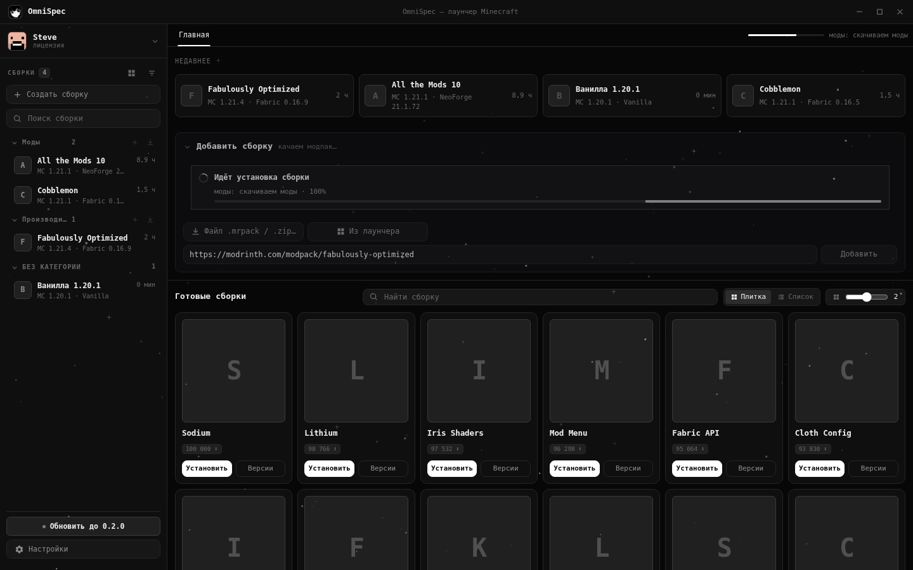

## Файлы: проводник и перетаскивание

* **Выбор файла и папки** — системные диалоги Windows: `.mrpack` в «Добавить
  существующую», `java.exe / javaw.exe` в настройках, папка данных.
* **Перетащи файл в окно** — лаунчер сам поймёт, что делать:
  `.mrpack` → новая сборка, `.jar` → в моды текущей сборки, `.zip` → в
  ресурспаки, `.png/.jpg/.webp` → иконка сборки.
* **`.mrpack` двойным щелчком** — установщик регистрирует ассоциацию, файл
  открывается в OmniSpec и сразу разворачивается в сборку (`inno`-подобные
  ассоциации настраиваются в `tauri.conf.json` → `bundle.fileAssociations`).
* **ПКМ по сборке** — меню: Играть/Остановить, Настройки сборки, Иконка из
  картинки, Переименовать, Открыть папку, Обновить файлы игры, Удалить.
* **Категории в сайдбаре раскрываются и сворачиваются только вручную** — кликом
  по заголовку (или ПКМ → «Свернуть / Раскрыть»). Лаунчер больше не открывает и
  не закрывает папки сам при выборе сборки: состояние не «прыгает» после
  перерисовок списка.

## Готовые сборки в главном окне

Пока сборка не выбрана, в главном окне — лента готовых сборок с Modrinth
(вкладка «Готовые сборки»): крупные карточки с иконкой проекта, названием,
описанием, категориями и числом скачиваний. Лента открывается на популярных
модпаках (`index=downloads`) и **догружается сама** при прокрутке — внизу видно
«ещё N» или «Показано всё».

Поиск по названию — **по центру и широкий** (до 560 px), справа — переключатель
«Плитка / Список» и **ползунок размера плиток**:

| Ползунок | Сколько карточек в ряд | Для чего |
|---|---|---|
| **1** | 12 | самый мелкий — окинуть взглядом всю ленту |
| **2** (по умолчанию) | 6 | обычный размер |
| **3** | 4 | крупные карточки с описанием |

Выбор запоминается в настройках (`feed_grid`). В плитке карточки открываются
кликом (окно сведений), поэтому кнопка «Страница» там скрыта — остаются
«Установить» и «Версии» одинаковой ширины.

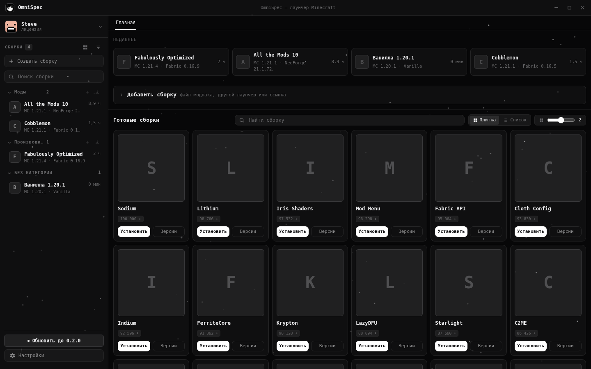

Главное правило: **ничего не выбирается автоматически**. Лаунчер не подставляет
первую сборку из списка и не открывает её настройки — сборка появляется в
сайдбаре выбранной только после того, как её выбрал ты. Кнопки на карточке:
«Установить» (ставит последнюю версию модпака новой сборкой), «Версии» (выбрать
конкретную) и «Страница» (откроется в браузере).

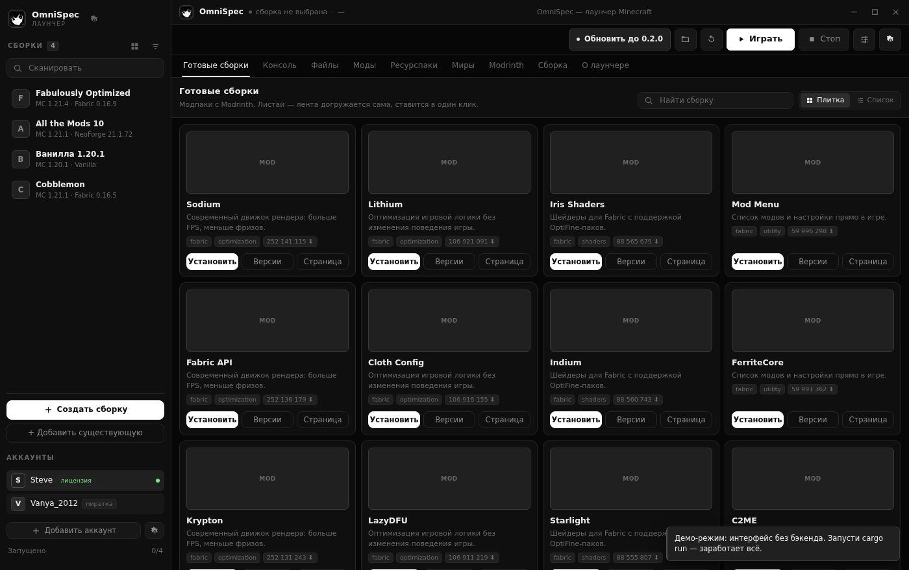

## Modrinth: лента, версии, вид

Вкладка «Modrinth» показывает результаты лентой: первые 24 карточки, дальше
подгрузка сама, когда прокручиваешь до низа (внизу видно «ещё N» или
«Показано всё»). Фильтры — тип, версия игры и загрузчик — применяются сразу.

У каждой карточки две кнопки:

* **Установить** — берёт последнюю подходящую версию (для мода — в текущую
  сборку, для модпака — создаёт новую сборку);
* **Версии** — окно со списком версий: номер, поддерживаемые версии игры,
  загрузчики, дата. Ставится ровно та, которую выбрал; список уже отфильтрован
  по версии игры и загрузчику текущей сборки.

Переключатель **Список / Плитка** справа в строке фильтров: список — широкие
строки с кнопками справа, плитка — сетка карточек с крупной иконкой.

**Иконка сборки приезжает вместе с модпаком.** Если сборка ставится с Modrinth,
лаунчер забирает `icon_url` проекта и кладёт картинку в папку сборки
(`instances/<id>/icon.png`), а в `instance.json` прописывает `icon`. Поэтому в
сайдбаре у каждого модпака своя иконка, а не первая буква названия. Свою картинку
можно поставить поверх: ПКМ по сборке → «Иконка из картинки…» либо перетащить
`.png/.jpg/.webp` в окно.

## Если Modrinth не открывается

Настройки лаунчера → «Сеть»:

* **Проверить связь с Modrinth** — короткий запрос и человеческое описание
  ошибки (DNS, сертификат, обрыв), а не сухое «error sending request».
* **Прокси** — `http://host:port` или `socks5://host:port`; применяется после
  перезапуска. Пусто — подключаться напрямую.

Поиск больше не повторяет запрос по кругу при ошибке: экран показывает причину
и кнопку «Повторить».

## Автообновление

Лаунчер при запуске тихо спрашивает GitHub: «есть ли релиз новее?». Если есть —
в шапке появляется кнопка **«Обновить до X.Y.Z»**: скачивает новый exe, подменяет
себя и перезапускается. Ничего удалять и переустанавливать не нужно.

* **Авто-обновление при запуске** — включено по умолчанию: найденную новую версию
  лаунчер ставит сам и перезапускается. Галочка в **Настройки → Обновления**,
  там же можно оставить только проверку без установки.
* Проверяется публичный репозиторий [`Shokydo/OmniSpec`](https://github.com/Shokydo/OmniSpec)
  (можно сменить в настройках, например на форк).
* Токен **не нужен** и в сборку не вшивается: публичные релизы доступны анонимно.
* Замена файла делается процессом-помощником (копия того же exe с флагом
  `--apply-update`), а не `.bat` — пути с кириллицей в `cmd.exe` ломаются.
* Проверено на реальном релизе: версия 0.1.1 скачала 0.1.2, подменила файл
  (sha256 совпал с релизом) и перезапустилась.

Скриншот настроек (**Настройки → Обновления**):

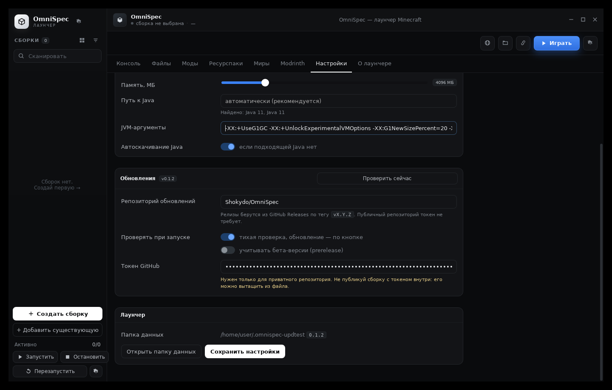

Полное описание, выпуск релиза и разбор проблем — в [`docs/UPDATES.md`](docs/UPDATES.md).

## Эффекты поверх окон

Фоновая анимация (звёзды, пыль, палочки, снег) и эффект клика живут на
отдельном канвасе **выше всего интерфейса** (`z-index: 5000`, у эффекта клика
5001): частицы видны и над окнами, и над диалогами настроек, и над уведомлениями.
Слой прозрачен для мыши (`pointer-events: none`), поэтому кнопки и поля под ним
работают как обычно. Цвет частиц берётся из `--text` темы — на светлой теме они
тёмные. Выключается всё в **Настройки → Эффекты**.

## Дизайн-система (из OmniPanel)

Палитра, геометрия и движок тем взяты из [OmniPanel](https://github.com/Shokydo/OmniPanel)
(`ui/style.css`): фон `#070708`, панели `#141417`, радиусы 8/12, сайдбар 280 px
с градиентом, белая «инвертированная» primary-кнопка и белая полоска у активной сборки.

В настройках → **Оформление** 16 тем: Тёмная, Графит, Контраст, Серая, Ночь, Океан,
Лес, Аметист, Закат, Уголь, Сталь, Светлая, Бумага, Снег, Мята, Песок. Из четырёх
цветов пресета (фон / панель / текст / акцент) выводятся все переменные интерфейса,
поэтому тема перекрашивает сайдбар, шапку, вкладки, модалки и консоль целиком.
Там же — эффект от клика мышью: волна, точка, кольцо, крест или выключен.


Тема и эффект сохраняются в `settings.json` и применяются при запуске.

Иконка приложения — присланная монохромная картинка; она стоит в сайдбаре,
в шапке окна, на exe, на ярлыках и на панели задач.

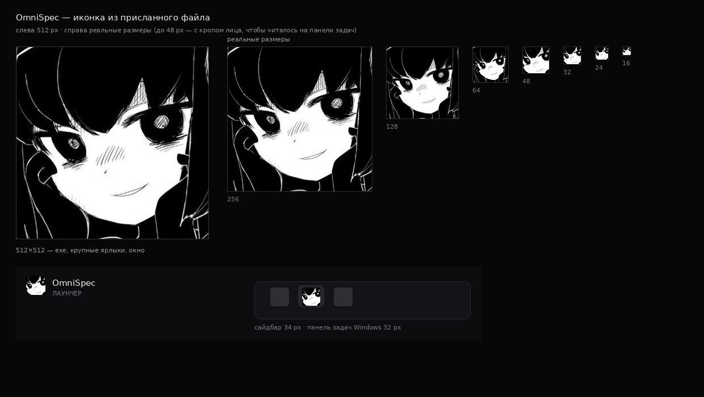

Набор собирается одной командой из исходника `apps/omnispec-app/icon-source.jpg`:

```bash
python3 tools/make-icons.py
```

Скрипт отдаёт мастер 1024 px (апскейл + шарп), PNG 32/64/128/256/512,
многоразмерный `icon.ico` (16…256) и логотип для интерфейса. Мелкие размеры
(≤48 px) берутся с кропом 68 % — лицо занимает больше места и иконка читается
на панели задач, крупные — полный кадр, как в исходнике.

## Где лежат данные

По умолчанию (Windows): `%APPDATA%\OmniSpec`
Linux: `~/.local/share/OmniSpec`

```
<данные>/
  settings.json                        настройки лаунчера (общие)
  accounts.json                        аккаунты (лицензия и офлайн) + выбранный
  meta/versions/<id>/<id>.json         профили версий (ваниль + загрузчики)
  meta/libraries/                      библиотеки (общие для всех сборок)
  meta/assets/                         ресурсы игры
  instances/<id>/instance.json         описание сборки
  instances/<id>/minecraft/            игровая папка сборки (mods, saves, config…)
  java/java-runtime-*/…                скачанные рантаймы Java
  logs/launch-<id>.log                 журнал запусков
```

**Портативный режим:** положи файл `portable.txt` рядом с `OmniSpec.exe` —
данные будут храниться в папке `OmniSpecData` рядом с программой. Установщик
создаёт этот файл сам (галочка на экране установки), поэтому после установки
данные лежат в `<папка установки>/OmniSpecData`, а не в профиле; какой режим
выбран, видно в `install-info.txt`.
**Свой путь:** переменная окружения `OMNISPEC_HOME=C:\Games\OmniSpec`.

---

## Как устроен код

```
omnispec/
├── crates/omnispec-core/          ядро без GUI (тесты: cargo test -p omnispec-core)
│   └── src/
│       ├── auth.rs                модель аккаунта, офлайн-UUID v3 от "OfflinePlayer:<ник>"
│       ├── auth/microsoft.rs      вход через Microsoft: device code → Xbox → Minecraft
│       ├── accounts.rs            accounts.json: список аккаунтов, активный, обновление токена
│       ├── update.rs              автообновление: GitHub Releases, подмена exe
│       ├── paths.rs               раскладка папок, portable-режим
│       ├── settings.rs            settings.json
│       ├── instances.rs           сборки (create/list/save/delete, playtime)
│       ├── net.rs                 HTTP + параллельные загрузки + прогресс
│       ├── game/
│       │   ├── mod.rs             манифест версий Mojang, склейка inheritsFrom
│       │   ├── version.rs         version.json, rules, дедупликация библиотек
│       │   ├── install.rs         клиент, библиотеки, нативы, ресурсы, log4j
│       │   ├── java.rs            поиск Java + загрузка рантайма Mojang
│       │   └── launch.rs          сборка аргументов и запуск процесса
│       ├── loaders/               fabric, quilt, forge/neoforge
│       ├── modrinth/              API v2: поиск, версии, установка, .mrpack
│       └── bin/omnispec.rs        CLI для проверки
├── .github/workflows/             release.yml (exe + релиз), ci.yml (тесты)
├── apps/omnispec-setup/           установщик: окно с кнопками + консольный режим
└── apps/omnispec-app/             Tauri-приложение
    ├── src/main.rs                команды (invoke) + события прогресса/лога
    └── ui/                        index.html, styles.css, app.js
```

Важные решения (и почему так):

* **Лицензионный вход** идёт по device-code: окно лаунчера не превращается в
  браузер, пароль не запрашивается, токены хранятся в `accounts.json` и
  обновляются перед запуском. Свой Azure-клиент не обязателен (см. «Аккаунты»).
* **Офлайн-UUID** считается как `md5("OfflinePlayer:<ник>")` с битами версии 3 —
  ровно как у самой игры. Поэтому права на offline-серверах и скины через
  сторонние сервисы совпадают с другими лаунчерами.
* **Дедупликация библиотек.** Fabric приносит свой ASM (9.10.1), а ваниль — 9.6.
  Если оставить оба, JVM падает с `duplicate ASM classes found on classpath`.
  При склейке профилей побеждает версия загрузчика (`game/version.rs`).
* **Свой log4j-конфиг.** Конфиг Mojang пишет в консоль XML (для лаунчера Mojang);
  мы генерируем читаемый, но с тем же файловым логом `logs/latest.log`.
* **Java не обязательна.** Если подходящей версии нет, рантайм скачивается с
  `launchermeta.mojang.com` и распаковывается в `java/` (проверяется реальным
  запуском `java -version`).
* **Обновление без внешнего установщика.** Новый exe заменяется процессом-помощником
  (копия того же exe с флагом `--apply-update`), а не `.bat`: пути с кириллицей в
  `cmd.exe` ломаются, а аргументы Windows передаёт в UTF-16.
* **Разрешения Tauri.** События (`progress`, `game-log`, `game-exit`) не работают
  без `capabilities/default.json` — если добавишь новые API, добавь и права.
* **Интерфейс без бэкенда.** Открой `apps/omnispec-app/ui/index.html` в браузере —
  увидишь тот же интерфейс на демо-данных (`app.js` сам определяет, есть ли Tauri).
* **Forge/NeoForge** ставятся официальным инсталлятором с `--installClient`,
  поэтому файлы попадают в `meta/`, а не в чужой `.minecraft`.

---

## Ограничения офлайн-режима (честно)

* Серверы с `online-mode=true` (лицензионные) не пустят — это не обходится и
  не поддерживается.
* Скины не отображаются у других игроков без мода/плагина (например,
  `CustomSkinLoader` + `ely.by`).
* Ник — это и есть идентификатор: смена ника = новый игрок (другой UUID).

---

## Что дальше (план в духе Prism Launcher)

Ближайшее:
1. Экспорт/импорт сборки в `.mrpack` и `.zip`
2. Резервные копии миров (архив `saves/` перед запуском)
3. Папка `resourcepacks` — установка паков с Modrinth в один клик (UI готов)
4. Обновление модов: показать «есть новая версия» на вкладке «Моды»
5. Переопределение Java/JVM-аргументов на уровне сборки ✅ (вкладка «Сборка»)

Дальше:
6. CurseForge как второй источник (см. `docs/CURSEFORGE.md`)
7. Пакетные операции со сборками, группировка, свой порядок
8. Проверка целостности по SHA1 (`settings.verify_hashes`)
9. Скриншоты/логи: просмотр `logs/latest.log` и `crash-reports` прямо в UI
10. Подпись кода (code signing), чтобы антивирусы не пугались подмены exe

---

## Лицензия

MIT. Проект не связан с Mojang/Microsoft. Игра не входит в комплект —
скачивается официально с серверов Mojang так же, как это делает лаунчер Mojang.
